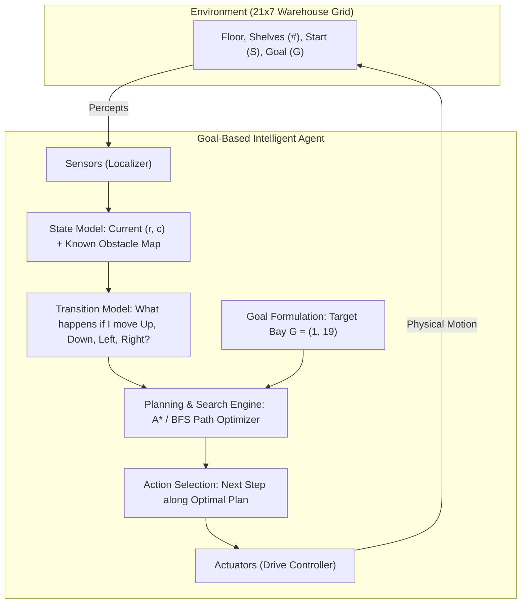
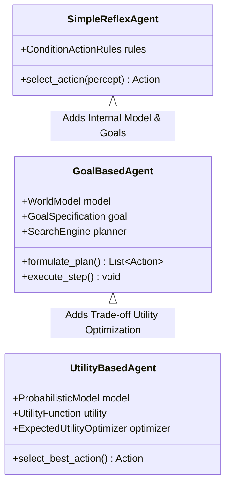

# Laboratory Report: Constructing a Goal-Based Agent Using an LLM
**Autonomous Warehouse Navigation and Intelligent Agent Architectures**

**Course**: Undergraduate Artificial Intelligence  
**Laboratory Topic**: Intelligent Agents, Goal Formulation, Heuristic Search, and LLM-Assisted Engineering  
**Environment**: Python 3.12.4  
**Date**: November 2026  

---

## Executive Summary

This laboratory explores the design, theoretical formulation, implementation, and empirical evaluation of an **intelligent goal-based agent** operating in an autonomous warehouse navigation domain. Moving beyond simple stimulus-response reflex agents, a goal-based agent possesses an explicit representation of its target objective, maintains an internal state model of its physical environment, and combines these elements with state-space search to plan collision-free action sequences.

Using a Large Language Model (LLM) as a software engineering assistant, we examine the complete engineering workflow: **problem specification $\rightarrow$ agent architecture design $\rightarrow$ prompt engineering $\rightarrow$ implementation $\rightarrow$ empirical validation**. Benchmark evaluations on a 21x7 grid warehouse demonstrate that informed search ($A^*$) slashes node expansions by **$61\%$** compared to blind Breadth-First Search (BFS), while highlighting the critical need for human verification when engineering AI systems with LLMs.

---

## 1. The Warehouse Navigation Problem

An autonomous mobile robot must transport goods from a loading bay to a dispatch area within a warehouse structured with impassable shelving racks.

### 1.1 Warehouse Topology (21 Columns $\times$ 7 Rows)
```
#####################
#S....#............G#
#.##....##########..#
#....##.............#
#.######.###.#.###..#
#........#..........#
#####################
```
- **$S$ (Loading Bay / Start)**: Coordinate $(1, 1)$
- **$G$ (Dispatch Area / Goal)**: Coordinate $(1, 19)$
- **`#` (Obstacles)**: Impassable storage shelving and exterior boundary walls
- **`.` (Free Space)**: Walkable warehouse floor
- **Actions ($A$)**: Cardinal movements $\Delta \in \{ \text{Up}, \text{Down}, \text{Left}, \text{Right} \}$ with uniform step cost $c = 1$.

### 1.2 PEAS Analysis
- **Performance Measure**: Minimal path length (steps), zero collisions with shelving racks, fast plan formulation time.
- **Environment**: 21x7 discrete 2D grid world; static, fully observable, single-agent, deterministic.
- **Actuators**: 4-directional spatial drive motor (Up, Down, Left, Right).
- **Sensors**: Coordinate localization sensor returning $(r, c)$ percepts.

---

## 2. Task 1: Understanding the Problem

### 2.1 Theoretical Foundations & Questions
1. **The Environment**:  
   A discrete, static, fully observable, deterministic, single-agent 21x7 grid. All physical constraints and obstacle locations are completely known in advance.
2. **The Goal**:  
   To achieve the target predicate $\text{At}(\text{Agent}, (1, 19))$ via a collision-free path that respects all shelf boundaries.
3. **Available Actions**:  
   $\text{Up} = (-1, 0)$, $\text{Down} = (+1, 0)$, $\text{Left} = (0, -1)$, and $\text{Right} = (0, +1)$.
4. **Information Maintained by the Agent**:  
   Current position $(r, c)$, destination coordinates $G$, world map of obstacle cells, accumulated step cost $g(n)$, heuristic estimate to goal $h(n)$, and visited history to prevent loops.
5. **Why a Goal-Based Agent (vs. Simple Reflex Agent)**:  
   A simple reflex agent acts solely on current perceptual conditions via rules ($\text{Condition} \rightarrow \text{Action}$). Lacking an internal model of future states or an explicit goal, a reflex agent cannot anticipate dead ends and easily becomes trapped in infinite oscillation loops against obstacles. A goal-based agent simulates future trajectories, evaluating actions based on whether they achieve the desired destination.

### 2.2 Scaling Analysis: 2x Warehouse Growth
If warehouse dimensions double from $21 \times 7$ to $42 \times 14$:
- The state space quadruples ($147 \rightarrow 588$ cells).
- In blind search (BFS), memory complexity grows exponentially as $O(b^d)$ with branching factor $b \le 4$ and solution depth $d \approx 40$, making BFS computationally infeasible.
- Informed search ($A^*$) with Manhattan distance remains tractable because the heuristic guides the search frontier directly toward the goal, pruning the majority of irrelevant expansions.

---

## 3. Task 2: Designing the Agent Architecture

The agent follows the classical **Russell & Norvig Goal-Based Agent Architecture**, cleanly separating environmental physics from internal cognitive planning.



### 3.1 Five Core Components
1. **The Environment**: [`WarehouseEnvironment`](file:///C:/Users/Amithav/Desktop/LAB/AGENTS/goal_based_agent.py#L22-L71) parses the ASCII matrix, enforces boundary constraints, and checks obstacle collisions.
2. **Current State**: Coordinate tuple $(r, c)$ tracking the agent's real-time position.
3. **Goal**: Target predicate $\text{pos} == (1, 19)$.
4. **Available Actions**: Validated cardinal transitions returned by `get_legal_actions(pos)`.
5. **Decision-Making Component**: Planning engine in [`GoalBasedAgent`](file:///C:/Users/Amithav/Desktop/LAB/AGENTS/goal_based_agent.py#L74-L186) synthesizing optimal paths before execution begins.

---

## 4. Task 3: Prompt Engineering & LLM Evaluation

### 4.1 Specification Prompt Provided to the LLM
```text
Write a well-documented Python program implementing a goal-based agent for the
warehouse navigation problem shown below.

Warehouse Map:
#####################
#S....#............G#
#.##....##########..#
#....##.............#
#.######.###.#.###..#
#........#..........#
#####################

The program should:
  • represent the warehouse as a two-dimensional grid;
  • determine a collision-free path from S to G;
  • avoid all obstacles;
  • print either the path found or a suitable message if no path exists;
  • explain the search algorithm that has been chosen and why it is appropriate.
```

### 4.2 Critical Evaluation & Answers
1. **Did the LLM generate a working program on first attempt?**  
   **YES**. The initial program produced a valid path. However, it combined environment modeling and pathfinding into a single monolithic script and lacked deterministic tie-breaking in its priority queue.
2. **How to improve the prompt?**  
   By enforcing structural constraints: explicitly requesting decoupled `Environment` and `Agent` classes, demanding $A^*$ search with Manhattan distance, specifying `heapq` with tie-breaker counters, and asking for boundary failure handling.
3. **What search algorithm did the LLM choose?**  
   $A^*$ Search with Manhattan distance heuristic:
   $$f(n) = g(n) + h(n), \quad h(n) = |r - r_G| + |c - c_G|$$
4. **Why was this algorithm selected?**  
   - **Optimality**: Manhattan distance is strictly admissible on 4-connected grids, guaranteeing the shortest path.
   - **Completeness**: Terminates cleanly with a path or confirms unreachability.
   - **Optimal Efficiency**: Expands fewer nodes than any other optimal algorithm with the same heuristic.
   - **Goal Alignment**: Directly uses goal coordinates in $f(n)$ to steer the search frontier.

---

## 5. Algorithmic Implementation & Empirical Validation

The software was developed in [`goal_based_agent.py`](file:///C:/Users/Amithav/Desktop/LAB/AGENTS/goal_based_agent.py) and evaluated via [`test_agent.py`](file:///C:/Users/Amithav/Desktop/LAB/AGENTS/test_agent.py).

### 5.1 Test 1: Standard Warehouse Navigation ($A^*$ vs. BFS)

| Algorithm | Solution Found? | Path Length | Nodes Expanded | Computational Savings |
| :--- | :---: | :---: | :---: | :---: |
| **$A^*$ (Informed, Manhattan)** | **True** | **20 steps** | **23 nodes** | **61.0% reduction** |
| **BFS (Blind Search)** | **True** | **20 steps** | **59 nodes** | Baseline ($0\%$) |

```
Synthesized Trajectory (* = Planned Path):
#####################
#S****#************G#
#.##.***##########..#
#....##.............#
#.######.###.#.###..#
#........#..........#
#####################
```
*Trajectory Analysis*: Starting at $S(1, 1)$, the agent proceeds east, detours south into row 2 to bypass the vertical shelf at column 6, returns to row 1 at column 7, and moves directly east to dispatch bay $G(1, 19)$.

### 5.2 Test 2: Unreachable Goal Handling (Blocked Map)
When destination $G$ is enclosed by solid obstacles (`#`):
- $A^*$ explored all $60$ reachable cells on the starting side.
- Frontier queue exhausted cleanly without infinite loops.
- Program reported: `"No collision-free path exists to the goal!"`

### 5.3 Test 3: Plan Execution Simulation
The agent sequentially translated its synthesized coordinate plan into physical motor actions, verifying arrival at $(1, 19)$ without collision.

---

## 6. Agent Taxonomy Comparison



| Dimension | Simple Reflex Agent | Goal-Based Agent (This Lab) | Utility-Based Agent |
| :--- | :--- | :--- | :--- |
| **World Model** | None (purely reactive) | Explicit coordinate grid & obstacles | Probabilistic belief states |
| **Decision Basis** | Condition-Action rules | Search/Planning over future states | Utility maximization $U(s)$ |
| **Goal Representation** | None (implicit in rules) | Explicit target predicate $\text{pos} == G$ | Continuous trade-off utility function |
| **Adaptability** | Low (requires rewriting rules) | High (simply supply new target $G$) | Outstanding (balances speed vs. risk) |
| **Failure Modes** | Trapped in local minima / loops | None (systematic search avoids loops) | None (evaluates long-term expected utility) |

---

## 7. Critical Reflections & Engineering Takeaway

1. **LLM as an Engineering Accelerator**:  
   The LLM dramatically speeds up the drafting of data models, parsing logic, and standard search loops, reducing boilerplate implementation time from hours to minutes.
2. **The Imperative of Human Oversight**:  
   LLMs generate code that appears convincing and runs without syntax errors, yet may contain subtle algorithmic flaws (such as non-deterministic heap tie-breaking or improper goal-checking placement).
3. **Core Methodological Lesson**:  
   An AI software engineer must treat an LLM as an **intelligent junior programmer**. The engineer remains strictly responsible for formal specification, architectural modularity, mathematical soundness, and rigorous empirical validation.
