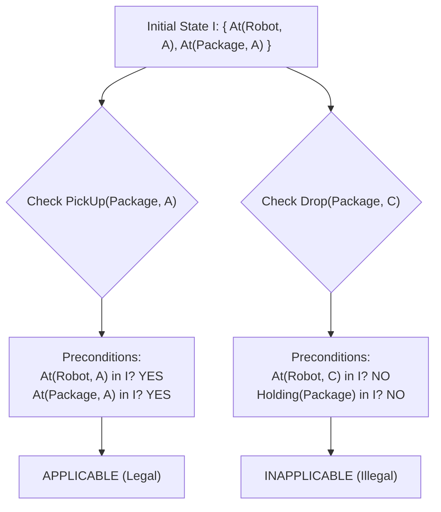
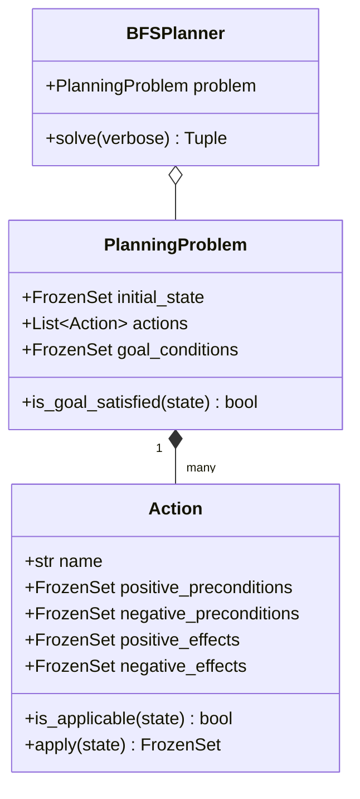
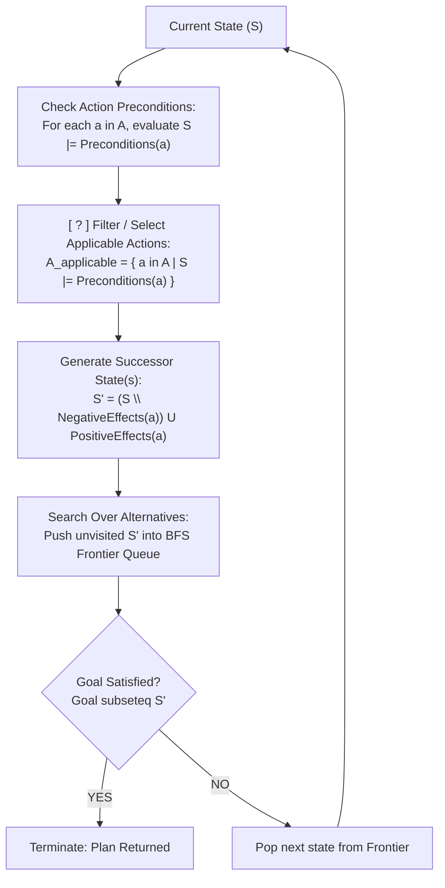

# Laboratory Report: Logical Reasoning for Planning
**Using an LLM to Construct, Test, and Formally Verify a Simple Planning Agent**

**Course**: Undergraduate Artificial Intelligence  
**Laboratory Topic**: Propositional Planning, Classical Search, and Logical Verification  
**Environment**: Python 3.12.4 | SWI-Prolog 10.0.2  
**Date**: November 2026  

---

## Executive Summary

This laboratory investigates the integration of **formal logic** and **state-space search** to solve classical automated planning problems. Using the STRIPS (Stanford Research Institute Problem Solver) formalism, an intelligent planning agent was designed, implemented in Python, evaluated across empirical benchmark tests, and verified through both mechanical Python state execution and declarative First-Order Logic in SWI-Prolog.

The overarching insight developed throughout this investigation is:
$$\text{Logic} + \text{Search} = \text{Planning}$$
where **logic** enforces physical validity by evaluating preconditions and state transitions, and **search** provides directional foresight to navigate alternative sequences of actions toward a specified goal. Furthermore, the laboratory demonstrates that while Large Language Models (LLMs) can rapidly synthesize algorithmic implementations from precise formal specifications, an LLM's natural language explanation cannot substitute for independent, deterministic verification.

---

## 1. Problem Formulation & Theoretical Foundations

### 1.1 The Planning Problem Triple $(I, A, G)$
A classical planning problem is formally modeled as a triple $(I, A, G)$:
1. **$I$ (Initial State)**: A finite set of ground propositional atoms representing known truths about the world at $t=0$.
2. **$A$ (Action Space)**: A set of deterministic operators parameterized by preconditions and effects.
3. **$G$ (Goal Specification)**: A set of target propositional atoms that must be satisfied by the terminal state ($S_n \models G$).

### 1.2 State Representation & Closed World Assumption (CWA)
States are represented as finite sets of positive ground literals. Under the **Closed World Assumption (CWA)**:
$$\text{If } p \notin S, \text{ then } p \text{ is false in } S$$
No explicit negative literals are stored in the state set; propositions are absent if and only if they are false.

### 1.3 STRIPS Action Schema
Each action $a \in A$ is defined by four proposition sets:
- $\text{Pre}^+(a)$: Positive preconditions that must be present in the state.
- $\text{Pre}^-(a)$: Negative preconditions that must be absent from the state.
- $\text{Eff}^+(a)$: Positive effects added to the state (Add-list).
- $\text{Eff}^-(a)$: Negative effects excised from the state (Delete-list).

An action $a$ is applicable in state $S$ if and only if:
$$S \models \text{Preconditions}(a) \iff (\text{Pre}^+(a) \subseteq S) \land (\text{Pre}^-(a) \cap S = \emptyset)$$

When applicable, the state transition function $\tau(S, a)$ computes the successor state $S'$ deterministically:
$$S' = \tau(S, a) = (S \setminus \text{Eff}^-(a)) \cup \text{Eff}^+(a)$$

---

## 2. Task 0: Understand the Planning Problem

### 2.1 Scenario Architecture
The domain features a mobile warehouse robot operating across three discrete waypoints: $A$, $B$, and $C$.
The physical corridors form a linear topology:
$$A \longleftrightarrow B \longleftrightarrow C$$
*(Note: There is no direct corridor connecting $A$ and $C$.)*

- **Initial State ($I$)**:
  $$I = \{ \text{At}(\text{Robot}, A), \text{At}(\text{Package}, A) \}$$
- **Goal State ($G$)**:
  $$G = \{ \text{At}(\text{Package}, C) \}$$

### 2.2 Complete Action Catalog
The ground action set $A$ contains 10 concrete operators:

| Action Name | Preconditions ($\text{Pre}^+, \text{Pre}^-$) | Negative Effects ($\text{Eff}^-$) | Positive Effects ($\text{Eff}^+$) | Physical Meaning |
| :--- | :--- | :--- | :--- | :--- |
| `Move(A, B)` | $\text{Pre}^+ = \{\text{At}(\text{Robot}, A)\}$ | $\{\text{At}(\text{Robot}, A)\}$ | $\{\text{At}(\text{Robot}, B)\}$ | Robot moves from $A$ to $B$ |
| `Move(B, A)` | $\text{Pre}^+ = \{\text{At}(\text{Robot}, B)\}$ | $\{\text{At}(\text{Robot}, B)\}$ | $\{\text{At}(\text{Robot}, A)\}$ | Robot moves from $B$ to $A$ |
| `Move(B, C)` | $\text{Pre}^+ = \{\text{At}(\text{Robot}, B)\}$ | $\{\text{At}(\text{Robot}, B)\}$ | $\{\text{At}(\text{Robot}, C)\}$ | Robot moves from $B$ to $C$ |
| `Move(C, B)` | $\text{Pre}^+ = \{\text{At}(\text{Robot}, C)\}$ | $\{\text{At}(\text{Robot}, C)\}$ | $\{\text{At}(\text{Robot}, B)\}$ | Robot moves from $C$ to $B$ |
| `PickUp(Package, X)` | $\text{Pre}^+ = \{\text{At}(\text{Robot}, X), \text{At}(\text{Package}, X)\}$, $\text{Pre}^- = \{\text{Holding}(\text{Package})\}$ | $\{\text{At}(\text{Package}, X)\}$ | $\{\text{Holding}(\text{Package})\}$ | Robot grasps package at location $X$ |
| `Drop(Package, X)` | $\text{Pre}^+ = \{\text{At}(\text{Robot}, X), \text{Holding}(\text{Package})\}$ | $\{\text{Holding}(\text{Package})\}$ | $\{\text{At}(\text{Package}, X)\}$ | Robot releases package at location $X$ |

*(where $X \in \{A, B, C\}$).*

### 2.3 Initial Applicability Analysis



1. **Is `PickUp(Package, A)` applicable from $I$?**  
   **YES**. The action requires $\text{At}(\text{Robot}, A)$ and $\text{At}(\text{Package}, A)$. Both propositions are present in $I$. Hence $I \models \text{Preconditions}(\text{PickUp}(\text{Package}, A))$.
2. **Is `Drop(Package, C)` applicable from $I$?**  
   **NO**. The action requires $\text{At}(\text{Robot}, C)$ and $\text{Holding}(\text{Package})$. Neither proposition is in $I$. Attempting this action violates domain physics (the robot cannot drop an object it does not hold at a location it has not reached).

> [!IMPORTANT]
> **Think About It (Task 0)**: An action is never applicable merely because it belongs to the domain vocabulary $A$. Logical evaluation $S \models \text{Preconditions}(a)$ serves as the semantic filter that prevents nonsensical actions from corrupting the state space.

---

## 3. Task 1: Construct a Plan by Hand

A plan $\pi = \langle a_1, a_2, \dots, a_n \rangle$ transforms $I \xrightarrow{a_1} S_1 \xrightarrow{a_2} \dots \xrightarrow{a_n} S_n$ such that $S_n \models G$.

### 3.1 Trace of State Transitions
Below is the manual derivation of the optimal plan:

| Step | Action Applied ($a_k$) | State Proposition Set ($S_k$) | Goal Satisfied ($S_k \models G$)? |
| :---: | :--- | :--- | :---: |
| **$S_0$** | *(Initial State)* | `{"At(Robot, A)", "At(Package, A)"}` | False |
| **$S_1$** | `PickUp(Package, A)` | `{"At(Robot, A)", "Holding(Package)"}` | False |
| **$S_2$** | `Move(A, B)` | `{"At(Robot, B)", "Holding(Package)"}` | False |
| **$S_3$** | `Move(B, C)` | `{"At(Robot, C)", "Holding(Package)"}` | False |
| **$S_4$** | `Drop(Package, C)` | `{"At(Robot, C)", "At(Package, C)"}` | **TRUE** |

**Derived Optimal Plan**:
$$\pi^* = \langle \text{PickUp}(\text{Package}, A),\, \text{Move}(A, B),\, \text{Move}(B, C),\, \text{Drop}(\text{Package}, C) \rangle$$
- Plan Length: 4 actions.

---

## 4. Task 2: Planner Implementation & Architecture

The planning agent was implemented in [`planner.py`](file:///C:/Users/Amithav/Desktop/LAB/LOGIC/planner.py) following the specification prompt.

### 4.1 System Components
- **`Action` Class**: Represents STRIPS operators using immutable `frozenset` collections for fast subset comparisons (`issubset`) and set differences.
- **`PlanningProblem` Class**: Enforces the domain triple $(I, A, G)$.
- **`BFSPlanner` Class**: Executes Breadth-First Search over the implicit state transition graph.
  - Maintains a double-ended queue `deque` of `(current_state, action_path, state_history)`.
  - Maintains a `visited: Set[FrozenSet[str]]` registry to ensure loop-free shortest path exploration.
  - Terminates immediately upon discovering any state $S$ where $G \subseteq S$.
  - Reports `"No plan found"` when the queue is exhausted.

### 4.2 Mapping Specification to Code



| Specification Concept | Role in Planning Theory | Code Element in `planner.py` |
| :--- | :--- | :--- |
| **Preconditions** | Defines when an action is legally applicable | `Action.is_applicable(state)` |
| **Effects** | Defines how the world changes deterministically | `Action.apply(state)` |
| **Goal** | Identifies termination criteria | `PlanningProblem.is_goal_satisfied(state)` |
| **BFS** | Navigates the frontier systematically to guarantee step optimality | `BFSPlanner.solve()` |

---

## 5. Task 3: Test the Generated Planner

To ensure empirical validity, three distinct test scenarios were executed via [`test_planner.py`](file:///C:/Users/Amithav/Desktop/LAB/LOGIC/test_planner.py) and mechanically validated using [`verify_plan.py`](file:///C:/Users/Amithav/Desktop/LAB/LOGIC/verify_plan.py).

### 5.1 Test Execution Matrix

```
======================================================================
SUMMARY OF TEST RESULTS (TASK 3 RECORD TABLE)
======================================================================
Test       | Initial State                    | Goal               | Found?   | Valid?  
-------------------------------------------------------------------------------------
Test A     | At(Package, A), At(Robot, A)     | At(Package, C)     | Yes      | True    
Test B     | At(Package, A), At(Robot, A)     | At(Package, C)     | No       | N/A (Correctly rejected)
Test C     | At(Package, A), At(Robot, A)     | At(Package, C)     | Yes      | True    
======================================================================
```

### 5.2 Test Scenarios Analysis
1. **Test A (Solvable Problem)**:
   - Initial State: $I = \{\text{At}(\text{Robot}, A), \text{At}(\text{Package}, A)\}$
   - Goal: $G = \{\text{At}(\text{Package}, C)\}$
   - Result: Optimal 4-step plan discovered after exploring 6 search nodes.
   - Verification: All intermediate preconditions verified; goal entailed at $S_4$.
2. **Test B (Impossible Problem - PickUp Action Removed)**:
   - Modifications: Removed `PickUp` from action space $A$.
   - Behavior: The search explored all 3 reachable states (robot wandering between A, B, and C while package remains stranded at A).
   - Result: Correctly reports `"No plan found"` without fabricating an imaginary move.
3. **Test C (Irrelevant & Distractor Actions)**:
   - Modifications: Added redundant operations (`InspectSensor`, `IdleBeep`, and movement without package).
   - Behavior: Verified that moving the robot to $C$ while leaving the package at $A$ produces $S = \{\text{At}(\text{Robot}, C), \text{At}(\text{Package}, A)\}$, which is correctly rejected by the goal checker.
   - Result: BFS discarded distractions and successfully returned the true delivery plan.

---

## 6. Task 4: Logic and Search Integration

### 6.1 The Synthesis Diagram



**Completed Description for the `[ ? ]` Box**:
> **"Filter / Select Applicable Action(s)"**  
> Formally: $A_{\text{applicable}}(S) = \{ a \in A \mid S \models \text{Preconditions}(a) \}$

### 6.2 Collaborative Synergy
- **Logic determines what is possible**: It provides the local, microscopic laws of causality. Without logic, search would evaluate impossible states (e.g. moving through nonexistent walls or dropping unheld objects).
- **Search determines what to try**: It provides global, macroscopic navigation. Without search, logic would remain a static catalog of immediate legal moves without direction.

---

## 7. Task 5: LLM Plan Verification vs. Independent Execution

### 7.1 Epistemological Comparison

| Feature | LLM Natural Language Justification | Independent Deterministic Engine (`verify_plan.py`) |
| :--- | :--- | :--- |
| **Computational Basis** | Autoregressive statistical token generation: $P(w_t \mid w_{<t})$ | Exact boolean set operations: $(S \setminus \text{Eff}^-) \cup \text{Eff}^+$ |
| **Failure Modes** | "Plausible hallucination", post-hoc rationalization of invalid steps | Immediate assertion failure on missing preconditions |
| **Guarantee** | None (heuristic text synthesis) | Mathematical proof of soundness under domain model |

> [!CAUTION]
> **Core Principle**: A generated explanation is NOT the same as an independent verification. In engineering intelligent autonomous systems, an LLM should be utilized as a candidate generator, but verification must always be enforced by an independent, sound logical system.

---

## 8. Tasks 6, 7 & 8: Prolog as a Formal Logical Verifier

Declarative logic programming in SWI-Prolog provides an independent formal verification layer completely decoupled from the Python runtime.

### 8.1 Task 6: Warehouse Topology Verification (`planner.pl`)
Knowledge Base:
```prolog
connected(a, b).
connected(b, a).
connected(b, c).
connected(c, b).

can_move(X, Y) :- connected(X, Y).
```

**Execution Results**:
- `?- can_move(a, b).` $\longrightarrow$ **`true.`**  
  *Proof*: Unifies $\{X=a, Y=b\}$ with rule; sub-goal `connected(a, b)` succeeds via matching ground fact.
- `?- can_move(a, c).` $\longrightarrow$ **`false.`**  
  *Proof*: Sub-goal `connected(a, c)` finds no matching fact in the database. By Negation as Failure (NAF), Prolog concludes it is false.

**Connection to Formal Logic**:
The Prolog rule `can_move(X, Y) :- connected(X, Y).` represents the definite Horn clause:
$$\forall X, Y.\; \text{Connected}(X, Y) \implies \text{CanMove}(X, Y)$$
which in clausal normal form is $\text{CanMove}(X, Y) \lor \neg\text{Connected}(X, Y)$.

### 8.2 Task 7: Verifying Proposed Plans
Extended with plan checking rules:
```prolog
valid_move(X, Y) :- connected(X, Y).

valid_move_plan([]).
valid_move_plan([move(X, Y)]) :- valid_move(X, Y).
valid_move_plan([move(X, Y), move(Y, Z) | Rest]) :-
    valid_move(X, Y),
    valid_move_plan([move(Y, Z) | Rest]).
```

**Queries**:
- `?- valid_move(a, b).` $\longrightarrow$ `true.`
- `?- valid_move(b, c).` $\longrightarrow$ `true.`
- `?- valid_move(a, c).` $\longrightarrow$ `false.`
- `?- valid_move_plan([move(a, b), move(b, c)]).` $\longrightarrow$ `true.`

**The Challenge**:
When a candidate generator proposes the shortcut `Move(a, c)`, the query `?- valid_move(a, c).` fails immediately. The verifier catches the invalid action and prevents execution.

### 8.3 Task 8: Deductive Implication Chains (`driving_reasoning.pl`)
Knowledge Base:
```prolog
wet_road.
slippery :- wet_road.
reduce_speed :- slippery.
```
Query: `?- reduce_speed.` $\longrightarrow$ **`true.`**

**Deductive Sequence of Implications**:
$$\text{wet\_road} \implies (\text{wet\_road} \to \text{slippery}) \implies (\text{slippery} \to \text{reduce\_speed}) \implies \text{reduce\_speed}$$
Form: $\text{Fact} \implies \text{Rule} \implies \text{Rule} \implies \text{Conclusion}$.

---

## 9. Comprehensive Reflection Answers

### 9.1 Section 5 Reflection Questions (General Planning)
1. **Why specify preconditions and effects before asking an LLM to write the planner?**  
   It converts ambiguous natural language into a strict formal contract. Without explicit STRIPS schemas, LLMs tend to invent arbitrary transition rules or omit domain constraints.
2. **Give an example of an error if preconditions are not checked.**  
   The robot could execute `Drop(Package, C)` at $t=0$ while still at $A$ without ever grasping the package. The state would falsely record the package at $C$, concluding the goal was met in 1 invalid step.
3. **Why is a plan that "looks reasonable" not necessarily valid?**  
   Human and LLM intuition often overlooks hidden topological disconnections (e.g., assuming $A$ and $C$ connect directly) or resource preconditions (e.g., carrying capacity). Formal validity requires an unbroken chain of logical entailment at every step.
4. **What did the LLM contribute?**  
   Rapid code generation: implementing the Python data models, BFS graph traversal, queue operations, and formatting routines in seconds.
5. **What had to be verified independently?**  
   Correctness of set delta operations, domain topology constraints ($A \not\leftrightarrow C$), goal evaluation semantics, and solver behavior under impossible conditions.
6. **Where is logical reasoning used?**  
   (a) Precondition satisfiability checks; (b) state set updates; (c) goal entailment; and (d) Prolog SLD resolution theorem proving.
7. **How does planning relate to earlier search algorithms?**  
   Planning is state-space graph search over an implicitly generated graph where nodes are proposition sets and edges are dynamically filtered applicable actions.

### 9.2 Section 7.2 Prolog Reflection Questions (Logical Verification)
1. **Difference between a Prolog fact and a Prolog rule:**  
   A fact is an unconditional ground assertion (e.g., `connected(a, b).`). A rule is a conditional Horn clause where the head is true only if all goals in the body are proved (e.g., `can_move(X, Y) :- connected(X, Y).`).
2. **How does a Prolog query correspond to knowledge base entailment?**  
   A query `?- Q.` asks whether $\text{KB} \models Q$. Prolog evaluates this through SLD resolution by attempting to derive a contradiction from $\text{KB} \cup \{\neg Q\}$.
3. **Why use Prolog to verify a Python plan?**  
   It provides an orthogonal, declarative verification environment that shares no mutable state, data structures, or code bugs with the Python generator.
4. **Advantage of an independent verifier for LLM outputs:**  
   It establishes a provable safety envelope. LLMs are non-deterministic and hallucination-prone; the verifier guarantees that only formally sound plans reach physical execution.

---

## 10. Conclusion & Methodological Takeaway

The central paradigm validated by this laboratory is:

$$\boxed{\text{Understand} \longrightarrow \text{Specify} \longrightarrow \text{Generate} \longrightarrow \text{Execute} \longrightarrow \text{Verify}}$$

Modern AI engineering reaches its highest reliability when pairing the **generative fluency of LLMs** with the **uncompromising rigor of formal logic and automated verification**.
