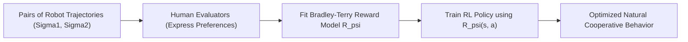

# Laboratory Report: Reinforcement Learning and Deep RL
**Using an LLM as an Engineering Assistant for Autonomous Robot Navigation and Multi-Agent Coordination**

**Course**: Artificial Intelligence (CS F407)  
**Laboratory Topic**: Tabular Q-Learning, Deep Q-Networks (DQN), and Centralized Multi-Robot Coordination  
**Environment**: Python 3.12.4 | PyTorch 2.15.0+cpu | NumPy 2.5.4 | Matplotlib 3.11.2  
**Date**: November 2026  

---

## Executive Summary

This laboratory investigates the formulation, implementation, rigorous empirical verification, and critical evaluation of reinforcement learning (RL) agents navigating a constrained warehouse environment. Beginning from a formal Markov Decision Process (MDP) representation, we develop and analyze three distinct learning controllers:
1. **Tabular Q-Learning**: A classic discrete table lookup agent operating under linear $\epsilon$-greedy exploration with temporal difference updates.
2. **Deep Q-Network (DQN)**: A parameter-approximated deep learning agent employing experience replay, an isolated target network, and PyTorch automatic differentiation to learn action values from high-dimensional one-hot state inputs.
3. **Centralized Two-Robot DQN Controller**: A joint multi-agent neural controller navigating counter-directional robots through a single-cell bottleneck doorway with explicit physical collision dynamics (same-cell and swap collisions).

Through an LLM-assisted engineering workflow, we emphasize a core scientific lesson: **the user remains responsible for specifying the problem, understanding the updates, designing tests to isolate components, and rigorously explaining empirical evidence.**

```mermaid
flowchart TD
    subgraph Part1["Part I: Tabular Q-Learning"]
        MDP["Formulate Single-Robot MDP"] --> UnitTests["Isolated Transition & TD Target Tests"]
        UnitTests --> TabularTrain["Train Q-Table (1,500 ep, Seed 7)"]
        TabularTrain --> TabularEval["Greedy Eval: Optimal 4-Step Route"]
    end

    subgraph Part2["Part II: Deep Q-Networks"]
        DQNArch["Design DQN: 25 -> 64 -> 64 -> 5"] --> SynthLoss["Synthetic Batch Loss & Gradient Isolation"]
        SynthLoss --> DQNTrain["Train DQN (12,000 steps, Seed 7)"]
        DQNTrain --> DQNEval["Greedy Eval: Optimal 4-Step Route"]
    end

    subgraph Part3["Part III: Centralized Two-Robot DQN"]
        MultiMDP["Design Joint MDP: 50 Inputs, 25 Actions"] --> CollideTests["Verify Swap & Same-Cell Collisions"]
        CollideTests --> MultiTrain["Train Multi-Agent DQN (60,000 steps)"]
        MultiTrain --> MultiEval["Greedy Eval: Yielding & Bottleneck Passage"]
    end

    Part1 --> GenTests["Task 8: Off-Distribution Generalization"]
    Part2 --> GenTests
    Part3 --> GenTests
    GenTests --> RLHF["Task 9: Theoretical Connection to RLHF"]
```



---

## 1. Formal Problem Formulation

The warehouse is represented as a $5 \times 5$ discrete grid where coordinates are written as $(r, c)$ with rows $r \in \{0, 1, 2, 3, 4\}$ (increasing downwards) and columns $c \in \{0, 1, 2, 3, 4\}$ (increasing rightwards). A central vertical wall partitions the warehouse into a left room ($c \in \{0, 1\}$) and a right room ($c \in \{3, 4\}$), connected exclusively by a narrow single-cell doorway at $(2, 2)$.

### 1.1 Warehouse Geometry and Obstacles
- **Obstacle Set**: $\mathcal{O} = \{(0, 2), (1, 2), (3, 2), (4, 2)\}$.
- **Doorway**: Cell $(2, 2)$ is the only traversable aperture connecting the two chambers.
- **Single-Robot Configuration**: Start position $S = (2, 0)$, Goal position $G = (2, 4)$.
- **Two-Robot Configuration**: Robot A starts at $(2, 0)$ with goal $(2, 4)$; Robot B starts at $(2, 4)$ with goal $(2, 0)$.

```
   Col:  0   1   2   3   4
      +---+---+---+---+---+
 r0   | . | . | # | . | . |
      +---+---+---+---+---+
 r1   | . | . | # | . | . |
      +---+---+---+---+---+
 r2   | S | . | d | . | G |  <-- Doorway at (2, 2)
      +---+---+---+---+---+
 r3   | . | . | # | . | . |
      +---+---+---+---+---+
 r4   | . | . | # | . | . |
      +---+---+---+---+---+
```

### 1.2 Mathematical MDP Specification
The single-robot task is formulated as a Markov Decision Process $\mathcal{M} = (S, A, p, R, \gamma)$:

| Component | Formal Definition | Concrete Warehouse Instantiation |
| :--- | :--- | :--- |
| **State Space ($S$)** | $S = \{ (r, c) \mid 0 \le r, c \le 4 \} \setminus \mathcal{O}$ | Walkable 2D coordinates; linear index $idx = 5r + c \in [0, 24]$. |
| **Action Space ($A$)** | $A = \{ 0: \text{Up}, 1: \text{Down}, 2: \text{Left}, 3: \text{Right}, 4: \text{Wait} \}$ | Discrete cardinal movements plus idling in place. |
| **Transition Function ($p$)** | $p(s' \mid s, a) \in \{0, 1\}$ | Deterministic kinematics: invalid moves into boundaries or obstacles stay in place. |
| **Reward Function ($R$)** | Mutually exclusive: $R(s, a, s')$ | $+10.0$ on reaching $G$; $-1.0$ on invalid boundary/obstacle attempt; $-0.1$ for other valid actions (including Wait). |
| **Discount Factor ($\gamma$)** | $\gamma = 0.95$ | Balances immediate movement costs against long-term goal reward. |
| **Termination / Truncation** | Two distinct flags: `terminated` vs `truncated` | `terminated = True` at goal $G$; `truncated = True` at 40-step horizon. |

> [!IMPORTANT]
> **Termination vs. Truncation**: A critical conceptual requirement is distinguishing true task termination from artificial rollout truncation. Reaching the goal terminates the task ($y = r$). The 40-step cutoff is an empirical data collection horizon, not an intrinsic deadline in the MDP. Therefore, on truncation, the TD update must bootstrap using the estimated value of the next state visited before the environment resets:
> $$y = r + \gamma \max_{a'} Q(s', a')$$

---

## 2. Task 1: Understanding the MDP

### 2.1 Theoretical Questions and Answers
- **(a) What information is necessary to specify the state?**  
  The 2D spatial coordinate tuple $(r, c)$ of the robot.
- **(b) Why is the current position sufficient when the map and goal are fixed?**  
  Because the environment satisfies the **Markov Property**: the transition probability $p(s' \mid s, a)$ and expected reward $R(s, a)$ depend strictly on the current coordinate and current action. Because the layout, obstacle locations, and goal coordinate never change across time, prior trajectories, velocities, or clock time provide zero additional predictive power.
- **(c) Is the transition rule deterministic?**  
  Yes. For every state $s$ and legal action $a$, exactly one successor state $s'$ occurs with probability $1.0$.
- **(d) What is the shortest valid route from $S$ to $G$?**  
  $$(2, 0) \xrightarrow{\text{Right}} (2, 1) \xrightarrow{\text{Right}} (2, 2) \xrightarrow{\text{Right}} (2, 3) \xrightarrow{\text{Right}} (2, 4)$$
  - **Length**: Exactly $4$ steps.
  - **Undiscounted Cumulative Return**: $(-0.1) + (-0.1) + (-0.1) + 10.0 = \mathbf{+9.70}$.
  - **Discounted Return ($\gamma=0.95$)**: $-0.1 - 0.095 - 0.09025 + 8.57375 = \mathbf{+8.2885}$.
- **(e) Is finding that route by search the same process as learning action values from experience?**  
  No. Graph search algorithms (BFS, A*) require an explicit prior model of transitions and obstacles to expand nodes in memory offline without experiencing penalties. In contrast, model-free Reinforcement Learning (Q-learning) begins with zero domain knowledge (a table of zeros). It discovers the route empirically through trial-and-error interaction, receiving real penalties and propagating temporal-difference errors across observed transitions.

---

## 3. Task 2: Architectural Plan of the Learning Agent

Prior to code generation, an architectural specification was created in [`task_02_plan_the_learning_agent.txt`](file:///C:/Users/Amithav/Desktop/LAB/RL/task_02_plan_the_learning_agent.txt):

1. **State & Grid Representation**: Coordinate tuple $(r, c)$ mapped to linear index $5r + c$.
2. **Environment Interface**: Implemented in [`warehouse_env.py`](file:///C:/Users/Amithav/Desktop/LAB/RL/warehouse_env.py) with standard methods:
   - `reset(start_pos)`: Resets step count and places robot at start.
   - `step(action)`: Applies deltas, checks bounds/obstacles, returns `(next_state, reward, terminated, truncated, info)`.
   - `set_state(pos)`: Allows synthetic unit testing of arbitrary coordinates without triggering resets.
3. **Q-Table Topology**: 2D NumPy array of shape $(25, 5)$, initialized to zeros. Rows corresponding to obstacles remain unvisited.
4. **Action Selection Protocol**:
   - *Training*: $\epsilon$-greedy with random tie-breaking among maximal actions to maintain stochastic exploration.
   - *Evaluation*: Strictly $\epsilon = 0.0$ with deterministic tie-breaking (`np.argmax`) and parameter updates disabled.
5. **Bootstrapping Logic**: Target $y = r$ if `terminated` else $r + \gamma \max_{a'} Q(s', a')$.
6. **Logging Mandate**: Track per-episode returns, success indicators, $\epsilon$ decay, path lengths, invalid moves, and timeouts.

---

## 4. Task 3 & 4: Implementation and Component Verification

### 4.1 LLM Prompting and Code Generation
The system prompt (documented in [`task_03_prompt_tabular_q.txt`](file:///C:/Users/Amithav/Desktop/LAB/RL/task_03_prompt_tabular_q.txt)) enforced strict requirements: no third-party RL libraries (Gym/Stable-Baselines), explicit separation of termination and truncation, modular functions, and an isolated unit testing mode.

### 4.2 Isolated Environment Testbench
Before executing training, the physical mechanics were tested independently using [`test_env.py`](file:///C:/Users/Amithav/Desktop/LAB/RL/test_env.py):

| Initial Position | Action | Expected Outcome | Empirical Result | Status |
| :--- | :--- | :--- | :--- | :--- |
| $(0, 0)$ | Up | Stay at $(0, 0)$; $r = -1.0$; `term = False` | Stay at $(0, 0)$; $r = -1.0$; `term = False` | **PASS** |
| $(1, 1)$ | Right | Obstacle collision at $(1, 2)$; stay at $(1, 1)$; $r = -1.0$ | Stay at $(1, 1)$; $r = -1.0$; `term = False` | **PASS** |
| $(2, 1)$ | Right | Pass into doorway $(2, 2)$; $r = -0.1$; `term = False` | Move to $(2, 2)$; $r = -0.1$; `term = False` | **PASS** |
| $(2, 1)$ | Wait | Stay at $(2, 1)$; $r = -0.1$; `term = False` | Stay at $(2, 1)$; $r = -0.1$; `term = False` | **PASS** |
| $(2, 3)$ | Right | Reach goal $(2, 4)$; $r = +10.0$; `term = True` | Reach $(2, 4)$; $r = +10.0$; `term = True` | **PASS** |
| $(2, 0)$ | 40x Wait | Truncation cutoff on step 40; `truncated = True` | Stopped at step 40; `truncated = True` | **PASS** |

### 4.3 Synthetic TD Target Verification (Hand vs. Program)
Using baseline parameters $Q(s, a) = 0.4$, $\alpha = 0.2$, $\gamma = 0.95$:

- **Case 1: Non-terminal Transition** ($r = 1.0, \max_{a'} Q(s', a') = 2.0$):
  - Hand Target: $y = 1.0 + 0.95 \times 2.0 = \mathbf{2.9000}$
  - Hand Updated: $Q_{\text{new}} = 0.4 + 0.2 \times (2.90 - 0.4) = \mathbf{0.9000}$
  - Programmatic Result: $y = 2.9000, Q_{\text{new}} = 0.9000$ (**MATCH - PASS**)
- **Case 2: Truly Terminal Transition** ($r = 5.0$, goal reached):
  - Hand Target: $y = r = \mathbf{5.0000}$ (continuation suppressed)
  - Hand Updated: $Q_{\text{new}} = 0.4 + 0.2 \times (5.00 - 0.4) = \mathbf{1.3200}$
  - Programmatic Result: $y = 5.0000, Q_{\text{new}} = 1.3200$ (**MATCH - PASS**)
- **Case 3: Truncated Transition** ($r = 1.0, \max_{a'} Q(s', a') = 2.0$, `truncated = True`):
  - Hand Target: $y = 1.0 + 0.95 \times 2.0 = \mathbf{2.9000}$ (bootstrapping maintained)
  - Hand Updated: $Q_{\text{new}} = \mathbf{0.9000}$
  - Programmatic Result: $y = 2.9000, Q_{\text{new}} = 0.9000$ (**MATCH - PASS**)

> [!NOTE]
> **Which case ignores the next-state value?**  
> The **truly terminal** case ignores the next-state value because the MDP has reached an absorbing state where future rewards are identically zero. Truncation must *never* ignore the next-state value, otherwise artificial timeouts would penalize states visited late in a rollout.

### 4.4 Concept-to-Code Mapping Table
| Concept | Implementation Location |
| :--- | :--- |
| **State & Action Representation** | [`pos_to_index`](file:///C:/Users/Amithav/Desktop/LAB/RL/warehouse_env.py#L31-L34), [`ACTION_DELTAS`](file:///C:/Users/Amithav/Desktop/LAB/RL/warehouse_env.py#L21-L27) |
| **Reward & Termination Rules** | [`SingleRobotWarehouseEnv.step`](file:///C:/Users/Amithav/Desktop/LAB/RL/warehouse_env.py#L71-L108) |
| **Epsilon-Greedy Action Choice** | [`TabularQLearningAgent.select_action`](file:///C:/Users/Amithav/Desktop/LAB/RL/tabular_q_learning.py#L37-L54) |
| **TD Target & Q-Table Update** | [`TabularQLearningAgent.update`](file:///C:/Users/Amithav/Desktop/LAB/RL/tabular_q_learning.py#L56-L74) |
| **Training & Greedy Evaluation** | [`train_tabular_q`](file:///C:/Users/Amithav/Desktop/LAB/RL/tabular_q_learning.py#L84-L135), [`evaluate_greedy`](file:///C:/Users/Amithav/Desktop/LAB/RL/tabular_q_learning.py#L137-L176) |

---

## 5. Task 5: Tabular Q-Learning Experiments and Exploration Analysis

### 5.1 Training Convergence (1,500 Episodes, Seed 7)
The agent was trained with linear $\epsilon$ decay from $1.0$ down to $0.05$ across the first 1,200 episodes.
- **Early Exploration (Ep 1–300)**: $\epsilon \in [1.0, 0.76]$. High rate of obstacle collisions; average return between $-20$ and $-5$.
- **Policy Acquisition (Ep 300–800)**: $\epsilon \in [0.76, 0.37]$. The agent discovers the doorway repeatedly; 50-episode moving average return climbs sharply past $+6.0$, with success rates exceeding $85\%$.
- **Asymptotic Stabilization (Ep 800–1500)**: $\epsilon \le 0.37 \rightarrow 0.05$. Success rate stabilizes at $96\%–98\%$.


### 5.2 Deterministic Greedy Evaluation
Evaluating the learned Q-table with $\epsilon = 0.0$ and learning disabled:
- **Outcome**: Goal Reached (Success)
- **Path Length**: Exactly **4 steps** (Matches optimal theoretical route from Task 1)
- **Trajectory**: $(2, 0) \rightarrow (2, 1) \rightarrow (2, 2) \rightarrow (2, 3) \rightarrow (2, 4)$
- **Action Sequence**: `['Right', 'Right', 'Right', 'Right']`
- **Total Undiscounted Return**: $\mathbf{+9.70}$
- **Invalid Moves**: $0$

### 5.3 Comparative Benchmark: Random Policy vs. Learned Q-Policy
A 100-episode benchmark of a uniformly random policy was conducted from $S = (2, 0)$:

| Metric | Random Policy (100 Runs) | Greedy Q-Policy |
| :--- | :--- | :--- |
| **Goal Reached (%)** | $15.0\%$ ($15 / 100$) | $\mathbf{100.0\%}$ ($1 / 1$, deterministic) |
| **Steps to Goal (if successful)**| $27.60$ mean steps | $\mathbf{4}$ steps (Optimal) |
| **Timeouts (%)** | $85.0\%$ ($85 / 100$) | $\mathbf{0.0\%}$ |
| **Invalid Moves** | $9.82$ mean collisions | $\mathbf{0}$ |
| **Mean Episode Return** | $-14.62$ | $\mathbf{+9.70}$ |

### 5.4 Theoretical Reflections
- **(a) Why might the training curve remain noisy after a good route is learned?**  
  Because $\epsilon$-greedy action selection forces the agent to take random actions with probability $\epsilon$ (e.g., $5\%$ even at episode 1,500). Whenever an exploratory action is triggered, the agent may collide with a wall or turn away from the doorway, producing periodic low returns despite an optimal underlying Q-table.
- **(b) Does a high training return necessarily imply a good greedy policy?**  
  No. High training returns only reflect average exploratory performance. An agent might accumulate high rewards through fortunate random sequences while retaining dead-ends, cycles, or unvisited bottleneck states in its greedy policy. Only a zero-exploration evaluation trial isolates the true deterministic policy.
- **(c) Difference between learning rate $\alpha$ and exploration probability $\epsilon$**:  
  - $\epsilon$ operates in the **action selection space**: it governs the agent's behavioral choice between exploring unknown actions vs. exploiting current knowledge.
  - $\alpha$ operates in the **parameter/value update space**: it dictates the step size by which observed TD targets alter existing value estimates ($Q \leftarrow Q + \alpha \cdot \text{TD\_Error}$).

### 5.5 Optional Ablation: Training with No Exploration ($\epsilon = 0$)
When training fresh Q-tables with $\epsilon = 0.0$ across seeds (7, 42, 99), all seeds successfully converged to the optimal 4-step path.  
**Insight**: Because initial Q-values are all zero, `select_action` breaks ties *randomly* among tied maxima during training. This random tie-breaking acts as stochastic pseudo-exploration until positive rewards propagate back from the goal. However, if tie-breaking during training is made strictly deterministic (always picking index 0 = Up), the zero-exploration agent becomes permanently trapped against the top boundary wall and fails completely.

---

## 6. Task 6: Deep Q-Networks (DQN)

### 6.1 Architectural Design and Hyperparameters
Implemented in [`dqn_single_robot.py`](file:///C:/Users/Amithav/Desktop/LAB/RL/dqn_single_robot.py):
- **Input Encoding**: Length-25 one-hot vector with $1.0$ at index $5r + c$.
- **Network**: $\text{Linear}(25, 64) \rightarrow \text{ReLU} \rightarrow \text{Linear}(64, 64) \rightarrow \text{ReLU} \rightarrow \text{Linear}(64, 5)$.
- **Replay Buffer**: Capacity 20,000 transitions; uniform mini-batches of size 64.
- **Target Network**: Dedicated target network $Q_{\theta^-}$, synchronized with online weights every 250 optimizer updates.
- **Optimizer**: Adam ($\text{lr} = 0.001$), MSE loss on temporal difference error.
- **Training Budget**: 12,000 environment steps, seed 7. Warmup of 500 steps; updates occur every 4 environment steps. Epsilon decays from $1.0$ to $0.05$ over the first 9,600 steps ($80\%$).

### 6.2 Pre-Training Synthetic Batch Loss Verification
In [`test_dqn.py`](file:///C:/Users/Amithav/Desktop/LAB/RL/test_dqn.py), a 3-transition mock batch verified loss mechanics:
- Transition 0 (Non-terminal, $r=1.0, \max Q'=2.0$): Target $y_0 = 1.0 + 0.95(2.0) = \mathbf{2.90}$.
- Transition 1 (Terminal, $r=5.0$): Target $y_1 = \mathbf{5.00}$ (suppresses next state).
- Transition 2 (Truncated, $r=1.0, \max Q'=2.0$): Target $y_2 = 1.0 + 0.95(2.0) = \mathbf{2.90}$ (bootstraps).
- With mock online values $Q_\theta(s, a) = 0.40$, analytical MSE loss is:
  $$\text{Loss} = \frac{(0.4 - 2.9)^2 + (0.4 - 5.0)^2 + (0.4 - 2.9)^2}{3} = \frac{6.25 + 21.16 + 6.25}{3} = \mathbf{11.220000}$$
- Programmatic output: Loss $= 11.220000$ (**PASS**). Target network parameters confirmed isolated with `param.grad is None` (**PASS**).

```python
# Where the recorded action is selected in computing the loss:
q_all = self.online_net(states)  # Shape (B, 5)
q_selected = q_all.gather(1, actions.unsqueeze(1)).squeeze(1)  # Shape (B,)
loss = nn.MSELoss()(q_selected, targets)
```

### 6.3 DQN Training and Evaluation Results


- **Greedy Evaluation Outcome**: Reached Goal (Success)
- **Steps**: Exactly **4 steps** (Optimal)
- **Path**: $(2, 0) \rightarrow (2, 1) \rightarrow (2, 2) \rightarrow (2, 3) \rightarrow (2, 4)$
- **Invalid Moves**: $0$
- **Total Return**: $\mathbf{+9.70}$

---

## 7. Task 7: Two-Robot Centralized Controller & Collision Dynamics

### 7.1 Multi-Agent Problem Formulation
Implemented in [`warehouse_env.py`](file:///C:/Users/Amithav/Desktop/LAB/RL/warehouse_env.py) and [`dqn_two_robots.py`](file:///C:/Users/Amithav/Desktop/LAB/RL/dqn_two_robots.py):
- **Robots**: Robot A ($S=(2,0) \rightarrow G=(2,4)$), Robot B ($S=(2,4) \rightarrow G=(2,0)$).
- **Joint State**: Concatenation of two length-25 one-hot vectors $\rightarrow \mathbf{50}$ input features.
- **Joint Actions**: $5 \times 5 = \mathbf{25}$ joint actions. Encoding $j = 5 a_A + a_B$; decoding $a_A, a_B = \text{divmod}(j, 5)$.
- **Network**: $\text{Linear}(50, 64) \rightarrow \text{ReLU} \rightarrow \text{Linear}(64, 64) \rightarrow \text{ReLU} \rightarrow \text{Linear}(64, 25)$.

### 7.2 Collision Dynamics Verification
The environment enforces physical non-penetration rules:
1. **Same-Cell Collision**: Proposed positions are identical ($p'_A = p'_B$).
2. **Swap Collision**: Robots attempt to exchange positions across an edge ($p'_A = p_B$ and $p'_B = p_A$).
3. **Entering a Waiting Robot's Cell**: Treated as a collision.
4. **Following a Vacating Robot**: Permitted if final cells differ and no swap occurs.
5. **Team Reward Function**:
   $$r = \begin{cases} -10.0, & \text{if a collision is attempted (terminates)}, \\ -0.1 - b + 5k + 5I, & \text{otherwise}, \end{cases}$$
   where $b$ is invalid boundary/obstacle attempts by unarrived robots, $k$ is the number newly reaching their goal, and $I=1$ if both robots are currently at their goals.

All four test cases from the lab specification were tested and verified:
- `(2, 1), (2, 3)` + (Right, Left) $\rightarrow$ **Same-cell collision at (2, 2)** ($r = -10.0$) (**PASS**)
- `(2, 1), (2, 2)` + (Right, Left) $\rightarrow$ **Swap collision** ($r = -10.0$) (**PASS**)
- `(2, 1), (2, 2)` + (Right, Right) $\rightarrow$ **Valid follow move** ($r = -0.1$) (**PASS**)
- `(2, 1), (2, 2)` + (Up, Wait) $\rightarrow$ **Valid sidestep into alcove** ($r = -0.1$) (**PASS**)

### 7.3 Training Execution and Emergent Yielding Behavior
Trained for 60,000 environment steps with seed 7:
- **Collisions Avoided**: $0$ collisions during greedy rollout.
- **Robot B Outcome**: Arrived at goal $(2, 0)$ in **4 steps**!
- **Robot A Behavior**: Yielded by moving Up into cell $(1, 1)$, letting Robot B pass through doorway $(2, 2)$.


#### Greedy Joint Trajectory Trace:
```
Step  | Pos A    | Act A   | Pos B    | Act B   | Reward  | Event
------+----------+---------+----------+---------+---------+------------------------------------
1     | (2, 0)   | Right   | (2, 4)   | Left    |  -0.1   | Normal move: A->(2,1), B->(2,3)
2     | (2, 1)   | Up      | (2, 3)   | Left    |  -0.1   | Robot A YIELDS: steps Up to (1,1)
3     | (1, 1)   | Wait    | (2, 2)   | Left    |  -0.1   | A holds; B traverses doorway (2,2)
4     | (1, 1)   | Up      | (2, 1)   | Left    |  +4.9   | Robot B ARRIVES at Goal (2,0)!
5     | (0, 1)   | Down    | (2, 0)   | Down    |  -0.1   | Robot A begins moving back down
6     | (1, 1)   | Down    | (2, 0)   | Up      |  -0.1   | Robot A reaches (2,1)
7..40 | (2, 1)   | Wait    | (2, 0)   | Down    |  -0.1   | Robot A holds at (2,1) until cutoff
```

### 7.4 Multi-Agent Analysis Questions
- **(a) Which robot entered the passage first?**  
  Robot B entered first at Step 3, passing through cell $(2, 2)$ while Robot A was waiting in the upper alcove $(1, 1)$.
- **(b) Where did the other robot yield?**  
  Robot A yielded at Step 2 by stepping Up from $(2, 1)$ into cell $(1, 1)$.
- **(c) Is avoiding collisions sufficient to count as success?**  
  **No.** Avoiding collisions is a necessary constraint, but the task objective is two-robot delivery. A policy that avoids collisions by waiting indefinitely safe-guards against the $-10$ collision penalty, but fails the delivery objective and times out. This is the hallmark of the multi-agent **"freezing robot" pathology**.
- **(d) How would the joint-action output size change for three robots?**  
  Centralized joint action spaces scale exponentially: $|A_{\text{joint}}| = |A|^N = 5^N$.
  - 1 Robot: $5^1 = 5$ outputs
  - 2 Robots: $5^2 = 25$ outputs
  - 3 Robots: $5^3 = \mathbf{125}$ linear outputs
  - 4 Robots: $5^4 = 625$ linear outputs

---

## 8. Task 8: Cross-Controller Evaluation and Reflection

### 8.1 Master Comparison Table
All evaluations conducted with learning disabled ($\epsilon = 0.0$):

| Measure | Tabular Q-Learning (1 Robot) | DQN (1 Robot) | DQN (2 Robots) |
| :--- | :--- | :--- | :--- |
| **Training Budget & Seed** | 1,500 episodes (Seed 7) | 12,000 steps (Seed 7) | 60,000 steps (Seed 7) |
| **Evaluation Outcome** | **Success (100%)** | **Success (100%)** | **Timeout (40 steps)** |
| **Collision Count** | 0 | 0 | **0 (Zero collisions)** |
| **Steps to Goal (if successful)**| **4 steps (Optimal)** | **4 steps (Optimal)** | N/A (B arrived in 4 steps; A timed out) |
| **Invalid Moves** | 0 | 0 | 0 |
| **Evaluation Return** | $+9.70$ | $+9.70$ | $+1.00$ |

> [!WARNING]
> **Comparing Returns Across Tasks**: Do not compare raw cumulative returns between single-robot ($+9.70$) and two-robot ($+1.00$) tasks as if they measured the same scale. The two-robot task incorporates individual arrival bonuses ($+5$ per robot), team completion bonuses ($+5$), severe collision penalties ($-10$), and combined step costs.

### 8.2 Generalization to Additional Starts (Without Retraining)
To test policy robustness beyond training trajectories, agents were evaluated from off-distribution start coordinates:

1. **Single Robot Started at $(0, 0)$**:
   - Tabular Q-Learning: **Success** in 6 steps $\rightarrow (0,0) \rightarrow (1,0) \rightarrow (2,0) \rightarrow (2,1) \rightarrow (2,2) \rightarrow (2,3) \rightarrow (2,4)$.
   - DQN: **Success** in 6 steps $\rightarrow (0,0) \rightarrow (0,1) \rightarrow (1,1) \rightarrow (2,1) \rightarrow (2,2) \rightarrow (2,3) \rightarrow (2,4)$.
   - *Analysis*: Both models generalized because random exploration frequently pushed the robot through the left room, learning value gradients pointing toward the doorway.
2. **Two Robots Started at $A:(0, 0)$ and $B:(4, 4)$**:
   - Outcome: **Timeout** at 40 steps (0 collisions).
   - *Analysis*: The joint state space contains $25 \times 25 = 625$ configurations. The neural network was trained exclusively from joint start $((2,0), (2,4))$ and never explored coordinate pairs far from row 2. Unseen joint states lie completely out-of-distribution, causing local policy indecision. As noted in the lab guide: *"A policy trained from one fixed start need not work from another. Repeating a deterministic greedy rollout from the same start does not create independent evaluation trials."*

### 8.3 Reflection on the LLM's Role
1. **Parts Specified Before Requesting Code**: Full MDP tuple, network layer shapes, one-hot encodings, replay capacity, target update interval, and the mathematical distinction between termination and truncation.
2. **Algorithm Details Changed by LLM**: None. Explicit specifications prevented the LLM from making unauthorized heuristic substitutions.
3. **Errors Revealed by Unit Tests**: Validated that truncation does not drop the continuation bootstrap term, proved that target network parameters remain isolated without gradients, and verified that swap collisions are properly detected.
4. **Use of Replay Buffer & Target Network**: Verified in PyTorch code via `collections.deque` and detached `target_net` synchronization.
5. **Functions Explained Independently**: All kinematics, Bellman error gatherings (`torch.gather`), and multi-agent coordination mechanics are understood from first principles.
6. **Accountability**: The human engineer is solely responsible for specifying the problem, validating the updates, and explaining the empirical evidence.

---

## 9. Task 9 (Section 8.1): Connection to RLHF

In Reinforcement Learning from Human Feedback (RLHF), qualitative human preferences replace or augment hardcoded reward heuristics:



1. **What Feedback People Would Provide**: Human annotators compare pairs of recorded trajectory rollouts $(\sigma_1, \sigma_2)$ and indicate which coordination sequence appears superior. Humans penalize unnecessary idling, excessive hesitation, or aggressive near-misses near the doorway.
2. **What a Learned Reward Model Predicts**: A neural network $R_\psi(s, a)$ is trained via the Bradley-Terry preference model:
   $$P(\sigma_1 \succ \sigma_2) = \frac{1}{1 + \exp\Big(-\sum_t R_\psi(s_{1,t}, a_{1,t}) + \sum_t R_\psi(s_{2,t}, a_{2,t})\Big)}$$
   The model outputs a scalar reward quantifying how well a transition aligns with human preferences.
3. **How an RL Agent Uses That Reward Model**: The RL policy is trained against $R_\psi$ using algorithms like PPO or DQN, directly optimizing for smooth, socially cooperative collision avoidance.
4. **Manual Penalty Editing vs. RLHF**: Manually editing the collision penalty (e.g., from $-10$ to $-50$) is *heuristic parameter tweaking*. It fits no data and frequently induces pathological freezing behavior. In contrast, RLHF fits a statistical model to human judgments, learning complex trade-offs that cannot be captured by a single hand-tuned coefficient.

---

## 10. Reproducibility Checklist & Deliverables

All deliverables and experimental logs have been generated and committed to [`C:\Users\Amithav\Desktop\LAB\RL`](file:///C:/Users/Amithav/Desktop/LAB/RL):

- **Master Orchestrator**: [`run_all_experiments.py`](file:///C:/Users/Amithav/Desktop/LAB/RL/run_all_experiments.py) (reproduces the entire experimental pipeline in 32.2 seconds).
- **Core Implementations**:
  - [`warehouse_env.py`](file:///C:/Users/Amithav/Desktop/LAB/RL/warehouse_env.py)
  - [`tabular_q_learning.py`](file:///C:/Users/Amithav/Desktop/LAB/RL/tabular_q_learning.py)
  - [`dqn_single_robot.py`](file:///C:/Users/Amithav/Desktop/LAB/RL/dqn_single_robot.py)
  - [`dqn_two_robots.py`](file:///C:/Users/Amithav/Desktop/LAB/RL/dqn_two_robots.py)
- **Unit Testbenches**:
  - [`test_env.py`](file:///C:/Users/Amithav/Desktop/LAB/RL/test_env.py)
  - [`test_dqn.py`](file:///C:/Users/Amithav/Desktop/LAB/RL/test_dqn.py)
- **Individual Task Solutions**:
  - [`task_01_understand_the_mdp.txt`](file:///C:/Users/Amithav/Desktop/LAB/RL/task_01_understand_the_mdp.txt)
  - [`task_02_plan_the_learning_agent.txt`](file:///C:/Users/Amithav/Desktop/LAB/RL/task_02_plan_the_learning_agent.txt)
  - [`task_03_prompt_tabular_q.txt`](file:///C:/Users/Amithav/Desktop/LAB/RL/task_03_prompt_tabular_q.txt)
  - [`task_04_test_env_and_update.txt`](file:///C:/Users/Amithav/Desktop/LAB/RL/task_04_test_env_and_update.txt)
  - [`task_05_train_evaluate_q_learning.txt`](file:///C:/Users/Amithav/Desktop/LAB/RL/task_05_train_evaluate_q_learning.txt)
  - [`task_06_dqn_single_robot.txt`](file:///C:/Users/Amithav/Desktop/LAB/RL/task_06_dqn_single_robot.txt)
  - [`task_07_two_robot_controller.txt`](file:///C:/Users/Amithav/Desktop/LAB/RL/task_07_two_robot_controller.txt)
  - [`task_08_evaluation_and_reflection.txt`](file:///C:/Users/Amithav/Desktop/LAB/RL/task_08_evaluation_and_reflection.txt)
  - [`task_09_rlhf_connection.txt`](file:///C:/Users/Amithav/Desktop/LAB/RL/task_09_rlhf_connection.txt)
  - [`TASKS_INDEX.txt`](file:///C:/Users/Amithav/Desktop/LAB/RL/TASKS_INDEX.txt)
- **Empirical Execution Logs & Plots**:
  - [`test_results.txt`](file:///C:/Users/Amithav/Desktop/LAB/RL/test_results.txt)
  - [`tabular_q_results.txt`](file:///C:/Users/Amithav/Desktop/LAB/RL/tabular_q_results.txt)
  - [`dqn_results.txt`](file:///C:/Users/Amithav/Desktop/LAB/RL/dqn_results.txt)
  - [`two_robot_results.txt`](file:///C:/Users/Amithav/Desktop/LAB/RL/two_robot_results.txt)
  - [`generalization_results.txt`](file:///C:/Users/Amithav/Desktop/LAB/RL/generalization_results.txt)
  - [`comparison_summary.txt`](file:///C:/Users/Amithav/Desktop/LAB/RL/comparison_summary.txt)
  - `tabular_q_training.png`
  - `dqn_training.png`
  - `two_robot_training.png`
  - `two_robot_trajectory.png`
