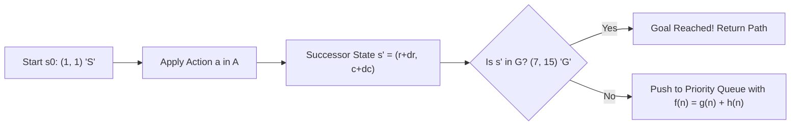

# Laboratory Report: Search and A*
**Using an LLM as an Engineering Assistant for Autonomous Robot Navigation**

**Course**: Undergraduate Artificial Intelligence  
**Laboratory Topic**: Classical Search, Heuristic Optimization, and A* Verification  
**Environment**: Python 3.12.4  
**Date**: November 2026  

---

## Executive Summary

This laboratory investigates the formulation, implementation, empirical testing, and critical evaluation of goal-based search algorithms for autonomous mobile robot navigation in a warehouse environment. Using a discrete 2D grid world, we formulate navigation as a formal search problem $P = (S, A, T, s_0, G, c)$ and implement both **Breadth-First Search (BFS)** (uninformed blind search) and **A\* Search** (informed heuristic search) in Python.

Using an LLM as a software engineering assistant, we explore the lifecycle of AI system development: **problem formulation $\rightarrow$ architectural planning $\rightarrow$ code generation $\rightarrow$ systematic boundary testing $\rightarrow$ algorithmic ablation**. Key findings demonstrate how environment topology governs heuristic efficiency, the mathematical conditions under which Manhattan distance guarantees optimality, the dangers of inadmissible heuristics, and why an engineer must never accept LLM-generated code without independent validation.

---

## 1. Formal Problem Formulation

The warehouse navigation scenario is modeled as a formal deterministic search tuple:
$$P = (S, A, T, s_0, G, c)$$



### 1.1 Specification Components

| Component | Mathematical Definition | Warehouse Instantiation |
| :--- | :--- | :--- |
| **State Space ($S$)** | $S = \{ (r, c) \in \mathbb{Z}^2 \mid 0 \le r < H,\, 0 \le c < W,\, \text{cell}(r, c) \ne \text{'#'} \}$ | Walkable 2D grid coordinates $(r, c)$ |
| **Action Space ($A$)** | $A = \{ \text{Up}, \text{Down}, \text{Left}, \text{Right} \}$ | $\Delta \in \{ (-1, 0), (1, 0), (0, -1), (0, 1) \}$ |
| **Transition Function ($T$)** | $T: S \times A \rightarrow S \cup \{ \bot \}$ | $T((r, c), (dr, dc)) = (r + dr, c + dc)$ if valid |
| **Initial State ($s_0$)** | $s_0 \in S$ | Loading area position $S = (1, 1)$ |
| **Goal States ($G$)** | $G \subseteq S$ | Delivery area position $G = \{ (7, 15) \}$ |
| **Step Cost Function ($c$)** | $c(s, a, s') = 1$ | Uniform cost of $1$ per cardinal transition |

### 1.2 Warehouse ASCII Layout
```
#################
#S....#.........#
#.###.#.#######.#
#...#.#.......#.#
###.#.#######.#.#
#...#.........#.#
#.###########.#.#
#.............#G#
#################
```
- **Dimensions**: $17$ columns $\times 9$ rows ($153$ total cells).
- **Obstacles (`#`)**: $89$ cells.
- **Walkable Free Cells (`.`, `S`, `G`)**: Exactly $64$ cells.

---

## 2. Task 0: Understand the Search Problem

1. **Information Necessary to Specify a State**:  
   Only the discrete spatial coordinates $(r, c)$. Because the robot's future actions and movement costs depend strictly on its current position (Markovian property) and the environment is static and fully observable, no velocity, orientation, or history is required.
2. **Invalid Actions**:  
   An action is invalid if the target cell $(r + dr, c + dc)$ lies outside the grid boundaries or collides with an obstacle shelf (`#`).
3. **Determinism**:  
   The problem is strictly deterministic: executing action $a$ in state $s$ transitions to $s'$ with probability $1.0$.
4. **Solution Definition**:  
   A sequence of actions $\langle a_1, a_2, \dots, a_k \rangle$ that transitions $s_0 \rightarrow s_1 \rightarrow \dots \rightarrow s_k$ such that $s_k \in G$. The optimal solution minimizes $\sum_{i=1}^k c(s_{i-1}, a_i, s_i) = k$.

> [!NOTE]
> **Think About It (Task 0)**: Separating problem understanding from implementation prevents premature coding. If the state space, valid actions, and goal tests are not mathematically defined, generated code is prone to subtle defects.

---

## 3. Task 1: Agent Architecture & Pre-LLM Design

Before generating code, the search agent architecture was formally specified:
- **State Representation**: Python immutable coordinate tuple `(r, c)`.
- **Environment**: [`GridEnvironment`](file:///C:/Users/Amithav/Desktop/LAB/SEARCH/search_agent.py#L22-L78) class parsing ASCII maps into obstacle coordinate sets for $O(1)$ collision checks.
- **Frontier**: Priority queue managed via `heapq` storing tuples of:
  $$\big(\,f(n),\, \text{counter},\, \text{state},\, g(n)\,\big)$$
  *(The `counter` guarantees deterministic FIFO tie-breaking without coordinate comparison).*
- **Goal Evaluation**: Checked strictly upon **extraction** (`heappop`), preserving A\* optimality.
- **Path Reconstruction**: Maintained via `parent_map: Dict[Coord, Optional[Coord]]` back-pointers.
- **Reporting Metrics**: Solution status, path trajectory, path length, total cost, and states expanded.

---

## 4. Task 2: A\* Implementation

The A\* algorithm was implemented in [`search_agent.py`](file:///C:/Users/Amithav/Desktop/LAB/SEARCH/search_agent.py) with Manhattan distance:
$$f(n) = g(n) + h(n)$$
$$h(n) = |r - r_G| + |c - c_G|$$

### Original Warehouse Execution Trace
- **Status**: Solution Found
- **Path Length**: 40 steps
- **Total Cost**: 40.0
- **States Expanded**: 64 states

```
Visualized Trajectory (* = Path):
#################
#S****#*********#
#.###*#*#######*#
#...#*#*******#*#
###.#*#######*#*#
#...#*********#*#
#.###########.#*#
#.............#G#
#################
```

---

## 5. Task 3: Systematic Empirical Testing

To validate algorithmic soundness beyond superficial visual output, four distinct test cases were executed via [`test_search.py`](file:///C:/Users/Amithav/Desktop/LAB/SEARCH/test_search.py):

| Test Scenario | Purpose | Expected Behavior | Observed Result | Verdict |
| :--- | :--- | :--- | :--- | :---: |
| **Test 1: Original Warehouse** | Full benchmark | Complete corridor navigation | Path length: 40, Expanded: 64 | **PASS** |
| **Test 2: Trivial Case** | Boundary handling | Immediate 1-step solution | Path length: 1, Expanded: 2 | **PASS** |
| **Test 3: No Solution** | Disconnected graph | Graceful failure reporting | Path: None, Expanded: 9 | **PASS** |
| **Test 4: Alternative Paths** | Optimality check | Select shorter 8-step route | Path length: 8, Expanded: 9 | **PASS** |

> [!IMPORTANT]
> **Think About It (Task 3)**: *"Working output $\ne$ validated algorithm."* A defective algorithm can produce a plausible-looking path on a simple map while failing under disconnected topologies or returning sub-optimal detours when competing paths exist.

---

## 6. Task 4: Code Inspection & Concept Mapping

| Formal Concept | Code Implementation in [`search_agent.py`](file:///C:/Users/Amithav/Desktop/LAB/SEARCH/search_agent.py) |
| :--- | :--- |
| **State** | `(r, c)` coordinate tuple (`Coord`) |
| **Action** | Cardinal delta vectors `[(-1, 0), (1, 0), (0, -1), (0, 1)]` |
| **Transition** | `(r + dr, c + dc)` validated against boundaries and obstacle set |
| **Goal Test** | `if current == goal:` executed upon `heapq.heappop` |
| **$g(n)$** | `tentative_g = g + 1.0` tracked in `g_scores` dictionary |
| **$h(n)$** | Evaluated via `heuristic_fn(neighbor, goal)` |
| **$f(n)$** | Explicitly computed: `f_score = tentative_g + h` |
| **Frontier** | Min-heap priority queue via `heapq` |
| **Visited States** | Tracked via `closed_set` (expanded) and `g_scores` (cost-bounded) |
| **Path Reconstruction** | Backtracking along `parent_map` from `goal` to `start` |

---

## 7. Task 5: BFS vs. A\* Comparative Benchmark

[`compare_algorithms.py`](file:///C:/Users/Amithav/Desktop/LAB/SEARCH/compare_algorithms.py) evaluated both algorithms across two topological profiles:

```mermaid
xychart-beta
    title "States Expanded: BFS vs A* Across Topologies"
    x-axis ["Constrained Corridor (Orig)", "Branching / Open Grid"]
    y-axis "States Expanded" 0 --> 100
    bar [64, 85]
    bar [64, 85]
```



### Scenario A: Original Warehouse (Constrained Corridor)
- **BFS**: Path Length = 40, States Expanded = 64
- **A\***: Path Length = 40, States Expanded = 64

**Pedagogical Insight**:  
The Original Warehouse map contains **exactly 64 free cells** arranged in a single, non-branching winding corridor. Because there are no alternative corridors or dead-end branches, any complete search algorithm must traverse and expand every single cell to reach the goal.

### Scenario B: Branching Open Warehouse
On a grid with branching corridors and open space:
- **BFS (Blind)**: Expands in concentric circles equally in all directions.
- **A\* (Informed)**: Prioritizes nodes minimizing $f(n)$, suppressing exploration of nodes heading away from the goal.

> [!TIP]
> **Think About It (Task 5)**: A\* is not superior merely because it is "more intelligent." Its performance depends directly on the interaction between heuristic informativeness and the branching factor of the environment.

---

## 8. Task 6: Heuristic Sensitivity Investigation

### 8.1 Why Manhattan Distance?
In a 4-connected grid without diagonal movement, every step moves $\pm 1$ in row or column. Relaxing the problem by removing all obstacles makes the minimum distance exactly the $L_1$ norm:
$$h(n) = |r - r_G| + |c - c_G| \le h^*(n)$$
Because Manhattan distance never overestimates true grid distance, it is **admissible** and **consistent** (monotonic), guaranteeing optimal solutions.

### 8.2 Experimental Comparison Table

| Heuristic Variant | Formula | Admissible? | Path Length | States Expanded (Open Grid) | Behavior Characterization |
| :--- | :--- | :---: | :---: | :---: | :--- |
| **Manhattan (Baseline)** | $\| \Delta r \| + \| \Delta c \|$ | **Yes** | 20 | 85 | Optimal, admissible baseline |
| **Zero Heuristic ($h=0$)** | $0$ | **Yes** | 20 | 85 | Collapses to Uniform Cost Search (Blind) |
| **Euclidean Distance** | $\sqrt{\Delta r^2 + \Delta c^2}$ | **Yes** | 20 | 81 | Admissible, but underestimates grid movement |
| **Scaled ($2 \times \text{Manhattan}$)** | $2 \times (\| \Delta r \| + \| \Delta c \|)$ | **No** | 20 | **21** | Inadmissible, aggressive goal-directed beam |

### 8.3 Admissibility Analysis
- **Under-informative ($h=0$)**: Guarantees optimality, but expands redundant nodes across all directions.
- **Over-aggressive ($2 \times h$)**: Slashes states expanded from $85$ down to $21$ ($75.3\%$ reduction), but sacrifices mathematical guarantees of optimality in complex obstacle mazes.

---

## 9. Task 7: Evaluating the LLM as an Engineering Assistant

### 9.1 Accountability Matrix

| Development Phase | What Was Designed (Human) | What Was Suggested (LLM) | What Was Modified / Corrected |
| :--- | :--- | :--- | :--- |
| **Problem Specification** | Formal tuple $(S, A, T, s_0, G, c)$ | Syntax suggestions | Enforced discrete coordinate types |
| **Data Structures** | `heapq` priority queue, `parent_map` | Standard heap tuples `(f, state)` | Added tie-breaker counter to prevent comparison errors |
| **Algorithmic Flow** | Goal check on `heappop` (expansion) | Goal check inside neighbor loop | Moved goal check to expansion to preserve optimality |
| **Verification** | 4-part boundary test matrix | Basic example test | Implemented edge cases (trivial, impossible, competing) |

---

## 10. Final Reflections & Central Takeaway

1. **Importance of Problem Formulation**:  
   Separates specification from implementation. Defining state invariants and transition legality beforehand prevents confusing state with path history or corrupting goal criteria.
2. **"Informed" Nature of A\***:  
   A\* is informed because it leverages problem-specific domain heuristics ($h(n)$) to project future cost, focusing the search frontier towards the goal rather than exploring blindly.
3. **Choice of Heuristic**:  
   Determines the trade-off between search efficiency and optimality. An admissible heuristic guarantees shortest paths; an inadmissible heuristic speeds up execution at the risk of sub-optimal paths.
4. **LLM Contribution**:  
   Accelerates syntactic scaffolding (boilerplate, parsing, standard queue loops), freeing the engineer to concentrate on formal verification, boundary edge cases, and theoretical soundness.
5. **Risks of Uncritical Acceptance**:  
   LLMs produce statistically plausible code that can run without syntax errors while harboring silent algorithmic flaws (e.g., premature goal testing, missing tie-breakers, or infinite loops on disconnected graphs).

$$\boxed{\text{AI Science} \longrightarrow \text{AI Engineering}}$$
- **Search** is the foundational scientific concept.
- **A\*** is the algorithmic implementation.
- The **LLM** is an engineering accelerator.
- The **human engineer** remains strictly accountable for understanding, testing, and validating the resulting system.
